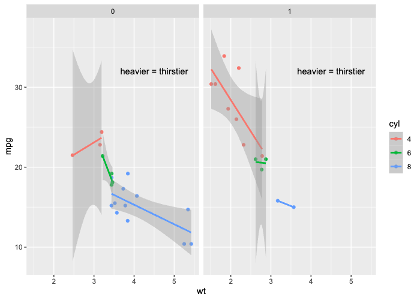
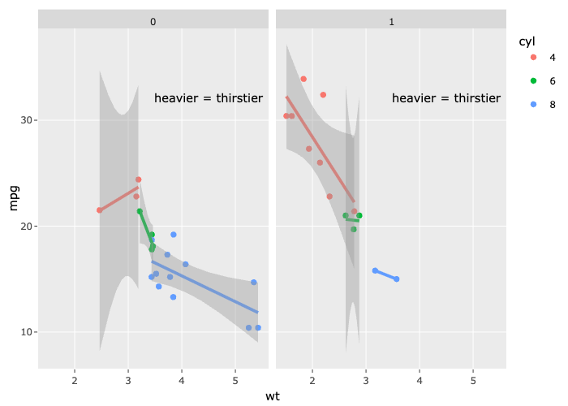
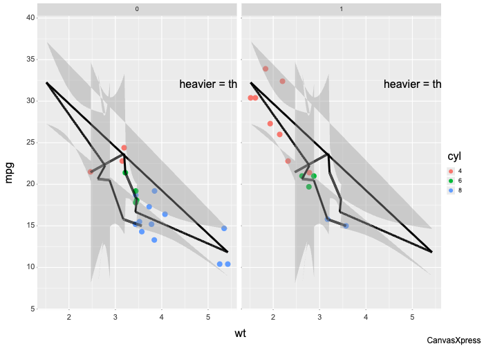
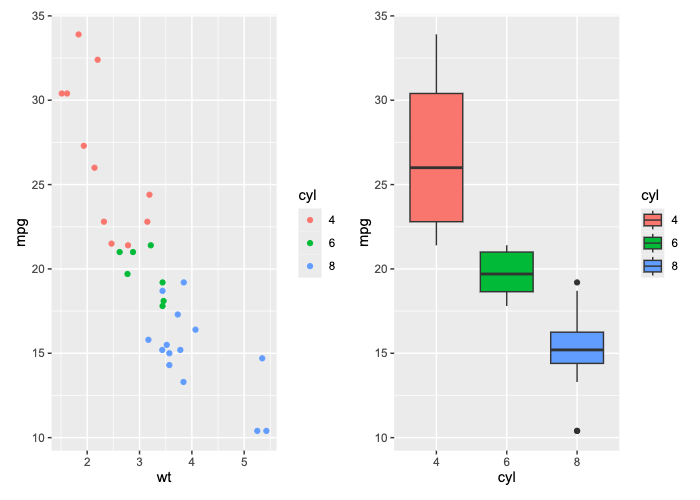
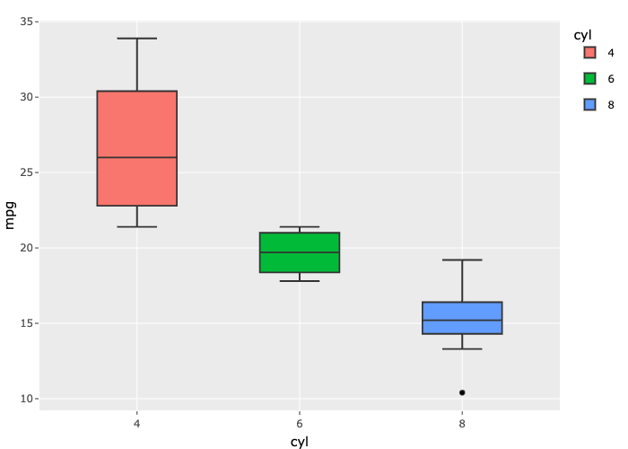
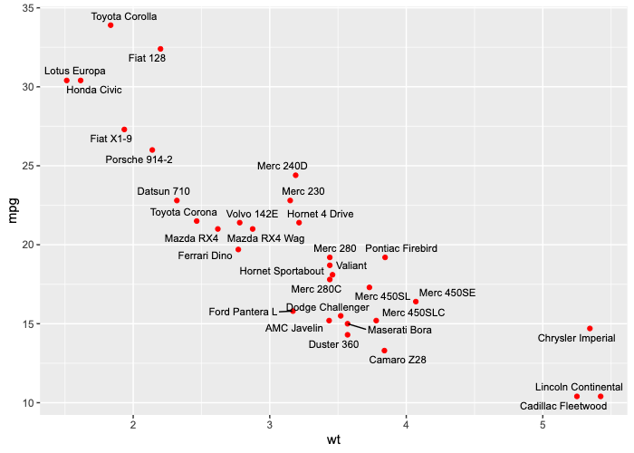
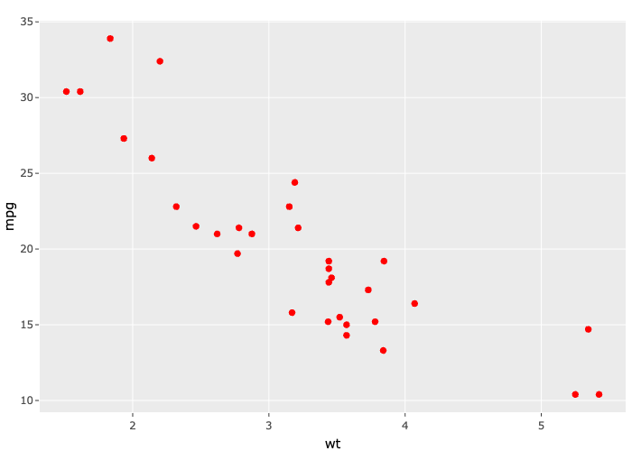
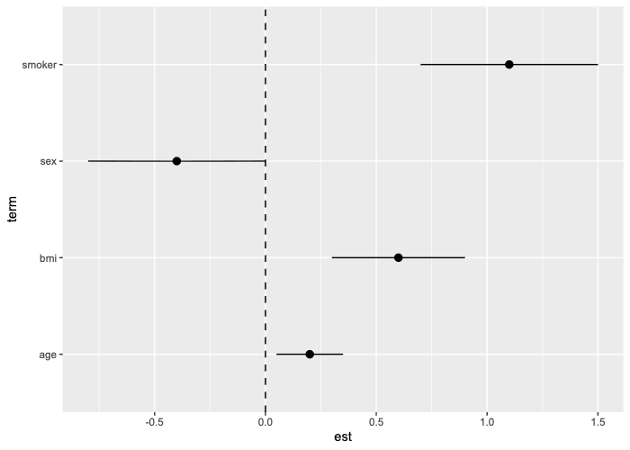
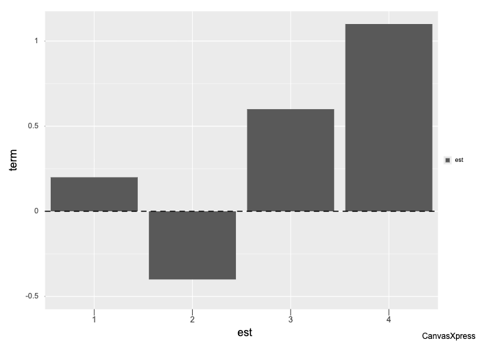

# 摘要 {.unnumbered}

R 的 ggplot2、base graphics、grid、ComplexHeatmap 等可视化系统都能导出 SVG。但 SVG 一离开图形设备，就只剩下几何形状：哪个元素是数据点，哪个是图例，这个点来自哪一行数据，那条标注想表达什么，全都丢失了。没有这些信息，就没法在导出的图上做语义化的交互、无障碍访问或二次编辑。

本报告回答三个问题：

1. 现有工具把 R 图变成可交互、带语义的图，各自做到了哪一步，又在哪里失败？
2. 这一方向还缺什么？
3. 应当怎样设计一个“语义最强”的导出方案？

主要结论如下。

- **现有方案分为五类，每一类都只能处理事先写好规则的输入。**
  - **规格翻译**（`ggplotly`、canvasXpress）把图重画到另一个引擎里，实测像素偏差 6–32%，而且经常**静默失败**：patchwork 只剩最后一个子图，ggrepel 标签全部丢失，森林图被画成柱状图。
  - **栅格 + 命中测试**（Shiny `nearPoints`）只知道分面，“点到哪一行”是查询时按距离猜的。抖动点只找回 1/32 行，第二个图层是 0/32。
  - **设备层打标签**（ggiraph、gridSVG、maidr）几何完全保真，但只给预先支持的 geom 绑定数据，遇到未知图层就返回空。
  - **事后解构**（DIVI、CSL、Athanor 等）对任意 SVG 都能用，但手里没有真实数据。在 R 生成的图上，两个大模型的元素角色识别 F1 分别为 0.692 和 0.959，同一批图差了 0.27，而且模型无从得知自己是否判断对了。
  - **语法原生**（Vega-Lite、Observable Plot）天生带语义，代价是要用它们的语法重写图。
- **“每个 SVG 元素来自哪个 grob”在技术上是可解的。** 对一张分面散点图的每个叶子 grob 逐个追踪，134 个图元中有 133 个得到 id，几何与原图逐字节一致。同样的方法在 patchwork、base 图和 ComplexHeatmap 上分别达到 139/140、63/64、227/228。
- **这个方向缺的是“导出时的真值 + 开放世界 + 可核验”。** 目前没有任何系统同时具备三点：导出时握有真实代码和构建后的数据；能处理没人写过规则的图层与语义；能把模型给出的每条语义核对到数据上。
- **本报告提出的方案是“代理只标注，从不重画”。** 管线分四步：
  1. 确定性骨架：元素 ↔ grob ↔ 数据行；
  2. 代理补充语义：角色、关系、领域含义、按图设计交互；
  3. 确定性编译：属性、ARIA、交互运行时；
  4. 校验：每个 grob 的元素计数、行绑定、声明核对、像素对比。

  第 2 步不确定，其余三步都是确定性的，几何始终不经过模型。

---

# 问题：R 图在导出时丢掉了什么 {#sec-problem}

## 一个最小实验

用一张常见的科研图做实验：mtcars 数据的车重 `wt` 对油耗 `mpg` 散点图，按气缸数 `cyl` 着色，每组加线性回归线和置信带，按变速箱类型 `am` 分面，再加一条文字标注“heavier = thirstier”。用 svglite 2.2.2 导出 SVG 后清点：

| 观察 | 结果 |
|---|---|
| 实际绘制的图元 | 134 个（35 circle、57 polyline、21 text、13 rect、5 polygon、3 line）；另有 5 个矩形只用于定义裁剪路径 |
| 带 id 或 `data-*` 属性的图元 | **0 个** |
| 圆形数量 vs 数据行数 | 35 vs 32，多出的 3 个是图例键，与数据点在 SVG 里无法区分 |
| 第 1 个分面的圆按绘制顺序与 `ggplot_build()` 数据行比对 | 完全一致（Spearman = 1.0） |

: 普通 svglite 导出的语义含量 {#tbl-spike}

最后一行说明，至少在简单情况下，元素和数据行之间的对应关系是**可以恢复的**，只是导出过程把它扔掉了。

## 为什么值得解决

- **交互**：悬停查看数据、点击图例筛选、在多个面板间联动高亮，前提都是知道元素代表什么。
- **无障碍**：读屏软件需要知道“这是一个数据点，属于 6 缸组，车重 3.2、油耗 21.4”，而不是“一个圆”。
- **二次编辑与复用**：知道哪些元素是同一个系列、哪条标注指向哪组数据，才能在矢量层面安全地修改图，而不是整张重画。
- **给 AI 读图**：大模型直接读一张只有几何的 SVG，只能猜。带语义的 SVG 让它可以查询，而不必猜测。

## 语义的五个层级 {#sec-levels}

为了比较各种方案，本报告把“语义”分为五层：

| 层级 | 内容 | 例子 |
|---|---|---|
| **S0** 几何 | 形状、坐标、颜色 | `<circle cx="215.3" cy="301.7">` |
| **S1** 结构 | 元素属于哪个 grob、图层、面板、viewport，是数据标记还是图例/坐标轴 | “第 1 面板、第 1 图层（点）的第 12 个元素” |
| **S2** 数据绑定 | 元素对应哪一行构建后的数据，再追到哪些原始行 | “Mazda RX4，wt = 2.62，mpg = 21.0” |
| **S3** 领域含义与关系 | 元素在领域中的意义，以及元素之间的关系 | “图例键 6 指向 6 缸系列”、“这个括号表示 A 与 C 组差异显著” |
| **S4** 交互意图 | 这张图应当支持哪些交互 | “悬停点显示车型；点击图例按缸数筛选；两个面板联动高亮” |

: 语义层级定义 {#tbl-levels}

::: {.callout-note}
**命名说明。** 本报告的层级用 S0–S4 表示，以避开两个已有术语：一是 Lundgard 与 Satyanarayan 提出的图表描述语义四层模型 L1–L4 [[Lundgard & Satyanarayan 2022](#ref-lundgard)]；二是 CSL [[CSL 2026](#ref-csl)] 使用的 “Semantic SVG（SSVG）”。
:::

---

# 研究方法 {#sec-method}

调研分四条并行线：

| 调研线 | 对象 | 主要证据 |
|---|---|---|
| A 设备层打标签 | ggiraph、gridSVG（另由文献线发现 maidr） | 源码阅读；对每个 grob 打标签的验证实验；浏览器运行时观察 |
| B 栅格 + 命中测试 | Shiny `plotOutput`、InteractiveComplexHeatmap | 源码阅读；实跑 Shiny 应用并抓取 websocket 消息；32 点命中实验；规模实测 |
| C 规格翻译 | `ggplotly`、canvasXpress | 源码阅读；同一组图三种渲染的像素对比；在线页面与 JS 引擎分析 |
| D 文献与生态 | 学术论文、Python/Web 生态、无障碍标准 | 逐条对照原始页面核实引文 |

: 调研设计 {#tbl-method}

**工具。** 除了读源码，A–C 三条线都用了两个逆向工程工具来获取运行时证据：REA 6.8.0 [[REA](#ref-rea)] 和 Craft Anything 0.5.0 [[Craft Anything](#ref-craft)]。运行时证据指的是只读源码看不到的东西：浏览器里实际挂着的事件监听器、websocket 里实际传输的内容、压缩 JS 的真实分支、渲染结果的像素差异。两个工具的实际贡献见[附录 A](#sec-tools)。

**核实。** 每条线的关键结论都经过二次抽查，包括：源码行号、生成的 SVG 属性、实验日志、截图。文献部分的引文逐条对照了出版方页面、arXiv 或代码仓库。只在 arXiv 上找到的条目，文中标为 [arXiv]。

**环境。** macOS（arm64），R 环境：ggplot2 4.0.3.9000、svglite 2.2.2、ggiraph 0.9.2、plotly 4.12.0、shiny 1.11.1、ComplexHeatmap 2.26.0、gridSVG 1.7-7；canvasXpress 和 gridSVG 装在隔离的临时库中。

---

# 现有方案逐类分析 {#sec-landscape}

## 规格翻译：把图重画到另一个引擎 {#sec-translate}

### 机制

**plotly `ggplotly()`。** 流程是 `ggplotly` → `gg2list`（复制了一份 ggplot2 的构建流程）→ `layers2traces`，把每个图层翻译成 plotly.js 的 trace。

- 提示框文本取自美学映射（aesthetic mapping）。
- 分面被拆成每个面板一组坐标轴，分面标签被转成注释。
- 遇到不支持的 geom，进入 `geom2trace.default`：发出一条警告，然后返回空列表，这个图层就消失了（`R/layers2traces.R:986-994`）。
- 没有针对 patchwork 的方法。
- `highlight_key()` 可以给数据行附加键，通过 crosstalk 实现跨控件联动。

**canvasXpress。** R 端的 `canvasXpress()` 遇到 ggplot 对象时调用 `ggplot.as.list()` → `gg_cxplot()`，发送一份 JSON 规格：原始数据（带行名 `Id`）、美学映射、展平后的主题（185 个键）、分面结构，以及逐图层的 `{geom, stat, params}`。

- JS 端把 geom 类名转换成方法名（如 `GeomTextRepel` → `geom_text_repel`），**只有这个方法存在时才调用；不存在就直接跳过，不发任何警告**。这是用 Craft 的 `js-sources-restore` 还原 4 MB 压缩引擎后发现的。
- 共有 63 个 geom 处理函数；pointrange、linerange、`label_repel`、sf 和自定义 grob 都没有。
- 引擎会自己重新拟合平滑曲线、自己放置排斥标签。
- 在线页面加载的 JS 与 R 包内置的副本逐字节相同。JS 采用源码可见许可，只在保留署名标识的前提下免费。

### 实验：同一组图，三种渲染

五张图分别用 svglite（作为基准）、`ggplotly`、canvasXpress 渲染，统一截图为 700×500 像素，再与 ggsave 生成的 PNG 比较。“差异”指通道差超过 16 级的像素占比，括号内是 SSIM。

| 图 | svglite 基准 | ggplotly | canvasXpress |
|---|---|---|---|
| (a) 分面 + 回归 + 着色 + 标注 | 1.6%（0.97） | 7.5%（0.82）；数据正确，图例键丢了线 | 24.7%（0.57）；**所有回归线画成一条黑色折线，并复制到两个面板**；标注被裁切 |
| (b) patchwork 拼图 | 2.2% | **只剩最后一个子图，无警告**；26.6% | 两个子图都在；18.9%；字号过小，元素碰撞 |
| (c) ggrepel 标签 | 4.8% | 发出警告，**32 个标签全部丢失**；6.5% | 用自己的算法放置标签；8.6%；没有引线 |
| (d) ComplexHeatmap | 2.0% | 报错；包装成 grob 后渲染为空白 | 报错；包装成 grob 后栈溢出 |
| (e) pointrange 森林图 | 1.6% | 正确；5.7% | **静默变成坐标轴互换的柱状图**；31.8% |

: 规格翻译的保真度实验 {#tbl-translate}

::: {#fig-translate-a layout-ncol=3}






图 (a)：同一张分面回归图的三种渲染。canvasXpress 把六条分组回归线画成了一条贯穿所有组的折线。
:::

::: {#fig-translate-silent layout-ncol=2}












规格翻译的静默失败。左列为原图，右列为翻译结果。
:::

### 结论

1. **翻译方案只能处理它的翻译表里有的东西。** 扩展 geom、自定义 grob、ComplexHeatmap、base 图都在表外；最好的情况是警告后丢弃，最坏的情况是静默画错。
2. **只看像素对比是不够的。** ggplotly 在 (c) 中丢掉了全部 32 个标签，像素差（6.5%）反而比 canvasXpress（8.6%）更小。校验必须同时检查元素数量和数据绑定。
3. 能达到的语义层级：S1 到“trace ↔ 图层”；S2 只有点序号加美学提示框，要拿到原始行需要 `highlight_key()`；没有 S3；S4 是引擎的固定交互集。

## 栅格 + 命中测试：不给元素语义，只算坐标 {#sec-raster}

### Shiny `plotOutput` + `nearPoints`

**机制。**

- **服务端**：`renderPlot` 输出 PNG，同时生成一张“坐标映射表”（coordmap）。ggplot 走 `getGgplotCoordmap`（`R/render-plot.R:579`），每个面板一条记录：数据范围、像素范围、对数底、分面取值。**列名只取第一个图层**（`:704`）。像素范围是通过重新实现 gtable 布局算法推算出来的。
- **客户端**：坐标映射表被刻意**不写进 DOM**，只存在于 JS 闭包中（`srcts/src/bindings/output/image.ts:111`）。事件监听器挂在外层容器上；点击时找到所在面板，把像素坐标反算回数据坐标。
- **回到数据行**：`nearPoints()` / `brushedPoints()` 把原始数据列投影到像素空间，再按距离和分面取值过滤。**“点到的是哪一行”是查询时的猜测，不是记录下来的链接。**

**实测：** 在 32 个点各自的绘制位置上点击，检查 `nearPoints` 能否找回正确的行。

| 情况 | 找回 |
|---|---|
| 普通、`facet_wrap`、`facet_grid`、自由刻度、`coord_flip`、对数、反转、`coord_fixed` | 各 32/32 |
| 离散 x | 27/32（漏掉的 5 个正好是 5 组重叠点） |
| `geom_jitter` | **1/32** |
| `coord_polar` | **0/32** |
| 第二个图层 | **0/32** |

: Shiny nearPoints 的行恢复率 {#tbl-shiny}

其他情况：

- patchwork、lattice、grid、ComplexHeatmap 都只拿到一张覆盖整张图、毫无意义的映射表；点击 patchwork 时实际发送的是 `x=0.5`。base 的 `par(mfrow)` 只映射最后一个面板。
- 点击图例被丢弃；刷选不能跨分面。
- 相关上游 issue 至今未关闭：rstudio/shiny #2411（抖动）、#1703（堆叠）、#2422（非 ggplot 的 grid 图）、#2938 和 #2300（映射列名）。
- 用 REA 抓取的 websocket 内容证实了上述行为：一条 181 KB 的消息里装着三张映射表；点击 base 多面板图时，客户端根本没有发送消息。

### InteractiveComplexHeatmap

它的思路不同：**不信任 Shiny 推算出的数据坐标，而是在绘制完成后，记录每个热图块在设备上的真实位置。**

- `htPositionsOnDevice`（`R/interactive.R:560`）在 `draw()` 之后用 `deviceLoc` 记录每个热图主体 viewport 的边界框。
- 点击时，按“点在块内的比例 × 切片大小”在聚类顺序上直接算出是哪一行、哪一列。
- **8 万个格子只需要一张 6 行、4.5 KB 的位置表**，并能精确定位到单个格子。这套方法离开 Shiny、在普通 PNG 设备上同样可用。
- 局限：注释值只对 4 种注释类型按索引关联；树状图、注释轨道和图例都不能点击。

### 规模实测

10 万个点的散点图：

| 形式 | 大小 |
|---|---|
| svglite SVG（尚未加任何 id） | 10.2 MB |
| PNG | 478 KB |
| 二进制点索引（原始大小） | 1.17 MB |

: 10^5 点的导出体积 {#tbl-scale}

### 结论

- 栅格方案的几何天然保真，体积也可控，但 Shiny 的做法只到“面板”这一层，而且绑定是猜出来的。它的每一种失败，都来自“把像素坐标反算回原始数据列”这一步。
- InteractiveComplexHeatmap 指出了更好的方向：**在绘制之后、从 viewport 树里记录位置**，而不是事后重新推算布局。
- 对于密集图层，“栅格 + 按（图层、面板、构建行）索引”是一条可行的退路。

## 设备层打标签：在绘制时记录元素归属 {#sec-device}

### ggiraph

**机制。**

- `layer_interactive()` 把 `data_id`、`tooltip` 等当作普通美学映射，带过 `ggplot_build`。
- `draw_panel` 给 grob 加上 `interactive_<类>_grob` 类。
- 绘制时，`drawDetails` 先打开一个 C++ 追踪器，正常绘制后再关闭（`R/interactive_points_grob.R:18-25`）。追踪器开启期间，自定义的 `dsvg` 设备记录下每个新建的元素（`src/dsvg_dev.cpp:117-120`），第 i 个值赋给第 i 个元素。

**局限。** 只有 `*_interactive` 图层会被标记；普通 ggplot 图层、base `plot()`、ComplexHeatmap（212 个元素中 0 个）都得不到 id。S1 只有“数据 / 图例键 / 主题元素”三类划分；交互菜单需要预先选定。

**实测中发现的失败模式：**

| 情况 | 结果 |
|---|---|
| 标签 `"a\nb\nc"` 与 `"d"` 共生成 4 个 text 元素 | 第 “c” 行被**静默**标成第二个标签的 id |
| 4 个元素对应 3 个 id | 发出警告，然后全部丢弃 |
| 点形 3/8 混用，32 行生成 81 个元素 | 之所以正确，只是因为对这两种点形写了特例 |
| 重叠的点 | 点击 “Valiant” 选中了 “Merc 280C” |
| id 稳定性 | 画布 id 随机生成，`_eN` 是全局计数器 |

: ggiraph 的失败模式 {#tbl-ggiraph}

**前端设计值得借鉴。** Craft 的 `web-listeners-list` 显示：数据点、图例键、回归线上的监听器数量都是 **0**；SVG 根节点上有 5–6 个，全部指向同一个 `MouseHandler.handleEvent`。也就是说，前端只在根节点做一次事件代理，再用属性选择器和类名切换完成所有交互。

### 关键验证：给**每一个** grob 打标签

为了检验“元素归属”在原理上能否做到完整，我们把同样的追踪思路用到上面那张图的**每一个叶子 grob** 上，包括坐标轴、图例、分面标签、回归线、置信带：

- 134 个图元中 **133 个**带上了 grob 路径、grob 内序号和类名；唯一没有的是设备自己画的背景矩形。
- 去掉 id 后，几何与普通 `print(p)` 的输出**逐字节相同**。
- 点图层：第 1 面板 19 个圆对应 19 行构建数据，第 2 面板 13 对 13，x 顺序相关系数 1.0，颜色也一致。
- 其他引擎：patchwork 139/140，base 图（经 gridGraphics 转为 grid）63/64，ComplexHeatmap 227/228。ComplexHeatmap 的语义藏在 viewport 名里，例如 `z_heatmap_body_1_1`（40 个格子）、`z_dend_row_1`、`annotation_cyl_1`。

**逐 grob 计数检查**：62 个叶子 grob 中有 6 个的实际元素数与预期不符，全部是带 NA 断点的网格线和含 NaN 的置信带，没有一个是数据标记。

这个结果有两层含义。

- 有了逐 grob 捕获，就不必在整张 SVG 上按绘制顺序对齐，只需在**单个 grob 内部**核对数量，而这是可以检查的。
- 数量对不上时必须**拒绝绑定并报告**（fail closed），绝不能像 ggiraph 那样循环补齐 id。

### gridSVG

- CRAN 1.7-7（2025-10-31），能配合 ggplot2 4.x 使用。导出约 0.5 秒，与 svglite 相比有 1.12% 的像素不同。
- 每个元素都有 id，例如 `geom_point.points.190.1.3`，并附带一份选择器/XPath 映射文件。能到 S1 和按索引的 S2，没有 S3/S4。
- 坑：grob 名里含会话计数器，id 跨会话不稳定；默认 `strict=TRUE` 会删掉 `data-*` 属性；`grid.garnish` 必须在 `grid.force()` 之后调用；逐元素模式下传标量属性会生成非法 XML。

### maidr

maidr 是一个很新的 R 包（CRAN 0.5.0，2026-09-29，GPL-3），目标是无障碍访问。

- **导出**：先 `grid.force()` + `grid.grab()` 整个场景，再逐个 grob 重画到 svglite 上。每次绘制前插入一个不可见的文字标记（`@@maidr-svg-mark@@k`），读回 SVG 后用标记把图元归位，再删除标记，输出 gridSVG 风格的 id。这是另一种完整的逐 grob 捕获方法，不需要自定义设备。
- **数据**：约 40 个手写的逐 geom 处理器，覆盖 ggplot2、base R、lattice、patchwork、pheatmap 和 ComplexHeatmap（热图格子、简单注释、树状图；标注为实验性）。遇到未知图层时，`Ggplot2UnknownLayerProcessor` 返回空数据和空选择器。
- **运行时**：固定的无障碍层，包括键盘导航、读屏、声音化和盲文。

### 结论

设备层方案证明了一件关键的事：**逐 grob 记录元素归属在技术上可行，而且几何完全保真。** 但三个工具在数据绑定上都是封闭的：只认识写过处理器的 geom，未知图层一律返回空；也都没有 S3、关系和按图设计的交互。

## 事后解构：从 SVG 或图片反推语义 {#sec-deconstruct}

这一类方法不要求访问源代码，直接从导出的 SVG 或位图反推语义。

| 工作 | 输入 | 恢复的语义 | 方法 | 结果 |
|---|---|---|---|---|
| ReVision [[ReVision](#ref-revision)] | 位图 | 图表类型；柱状图/饼图的标记和数据 | 计算机视觉 + SVM | 分类准确率 96%；柱状图数据提取 71% |
| D3 Deconstructor [[D3 Deconstructor](#ref-d3decon)] | 运行中的 D3 页面 | 数据、标记属性、映射 | 读取 D3 绑定在 DOM 上的 `__data__` | 绑定精确，但仅限 D3 |
| Poco & Heer [[Poco & Heer 2017](#ref-poco)] | 位图 | 文本角色、标记类型、编码规格 | CNN + OCR | 文本角色 F1 ≥ 98% |
| ChartDetective [[ChartDetective](#ref-chartdetective)] | 矢量 PDF/SVG | 坐标轴、系列、数据 | 半自动 | 相对误差 0.11% |
| Mystique [[Mystique](#ref-mystique)] | SVG | 坐标轴、图例、布局 | 启发式 + 向导 | 坐标轴/图例 > 85%，布局 96% |
| DIVI [[DIVI](#ref-divi)] | ggplot2、matplotlib 等的 SVG | 坐标轴、图例、标记、推断的数据字段 | 运行时启发式 | 箱线图、密度、平滑曲线无法仅从 SVG 推断 |
| VisAnatomy [[VisAnatomy](#ref-visanatomy)] | 942 张真实 SVG，来自 50 多种工具（含 R） | 38.3 万个元素的类型、角色、分组、编码 | 人工标注语料 + 大模型基线 | 角色识别平均 F1 ≈ 0.84；**R 图上 GPT-4o 0.692、DeepSeek-V3 0.959** |
| CSL [[CSL 2026](#ref-csl)] [arXiv] | 已部署的 SVG | 标记类型、可视化角色、数据角色 | 结构指纹分组 + 多模态大模型 + 确定性校验 | 准确率 0.82–0.86；先分组再提问显著优于整图提问 |
| Athanor [[Athanor](#ref-athanor)] [arXiv] | SVG | 角色、比例尺、约束模型；自然语言生成交互 | 多模态大模型 + 多智能体 | 案例研究，无准确率数据 |

: 事后解构的代表性工作 {#tbl-decon}

2024–2026 年还有几项相关工作：

- Live Charts [[Live Charts](#ref-livecharts)]：用图神经网络标注 SVG 组件，再由大模型生成动画和旁白。
- DataWink [[DataWink](#ref-datawink)]：大模型把 SVG 范例标记成分层表示，再插入数据驱动的元素。
- Chart2SVG [[Chart2SVG](#ref-chart2svg)] [arXiv]：从位图生成语义 SVG，并把角色限定在一个封闭词表里。
- Figures as Interfaces [[Figures as Interfaces](#ref-nexus)] [arXiv]：让图在生成时就嵌入数据、代码和“标记 ↔ 数据行”的双向映射。它和本报告的出发点相同（“导出后就只剩像素”），但只适用于在它自己的系统里生成的图。

**结论。** 事后解构方法覆盖面最广，但缺少真值。

- 同一批 R 图上，两个大模型的 F1 相差 0.27，说明只凭 SVG 推断语义很不稳定。
- 更根本的问题是，模型无法知道自己是否推断对了。
- chart-to-code 方向的结果从另一面印证了这一点：在 ChartEdit 基准上，GPT-4o 没有源代码时得 59.96 分，有源代码时得 89.96 分 [[ChartEdit](#ref-chartedit)]。**握有原始代码，是提升最大的单一因素。**

## 语法原生与无障碍标准 {#sec-native}

- **Vega-Lite / Observable Plot**：数据从一开始就绑定在标记上。Vega ≥ 5.11 会自动给标记组加 ARIA 角色、给坐标轴和图例加说明，并且**默认不给单个数据项加 ARIA**，以免页面臃肿。Observable Plot 支持逐数据项的 `ariaLabel` 和用于隐藏装饰元素的 `ariaHidden`。代价是必须用它们的语法重写图。
- **Python 生态可作对照**：
  - mpld3 遍历 matplotlib 图形对象，再用 D3 重画，本质仍是重绘。
  - matplotlib 的 `set_gid` 加官方示例展示了“导出后靠 id 绑定”的手工做法。
  - py-maidr 在绘制时给每个图元分配 gid。
  - plotly 的 `mpl_to_plotly` 曾被宣布弃用，理由是“太难做到完美转换”，且无法跟上 matplotlib 的变化。这和上文规格翻译暴露的问题是同一个：重新实现一套绘图库的语义，迟早会与上游脱节。
- **WAI-ARIA Graphics Module 1.0** [[WAI-ARIA Graphics](#ref-aria)]：定义了三个角色。`graphics-document` 是图形的根，可以嵌套，规范建议多面板图的每个面板都用它；`graphics-object` 是有语义的子部件；`graphics-symbol` 是原子符号，可配合 `aria-roledescription` 说明符号类型。SVG-AAM 仍是工作草案。
- **Olli、Data Navigator** [[Olli](#ref-olli); [Data Navigator](#ref-datanav)]：把图表结构组织成可导航的树或超图，用边表达树结构表达不了的关系。**Chartability** [[Chartability](#ref-chartability)] 提供无障碍审查清单。
- **声明溯源** [[Blanco et al. 2026](#ref-claims)] [arXiv]：把大模型对图表的陈述分为 Direct、Derived、Speculative 三类。他们的例子里图上画了 342 只企鹅，而源数据有 344 行，这说明**核对必须针对构建后、经过过滤的数据，而不是原始表**。

---

# 综合比较：缺的是哪一块 {#sec-gap}

| 方案类别 | S1 | S2 | S3 | S4 | 世界 | 几何 | 需改写代码 |
|---|---|---|---|---|---|---|---|
| 位图逆向（ReVision、Poco & Heer） | 推断 | 近似 | — | — | 封闭 | 丢失 | 否 |
| D3 DOM 绑定（D3 Deconstructor） | 精确 | 精确 | — | 重新配色 | 封闭，仅 D3 | 保留 | 否 |
| SVG 启发式（Mystique、DIVI） | 推断 | 推断 | — | 固定 | 封闭 | 保留 | 否 |
| 大模型读 SVG（CSL、Athanor） | ≈0.84 | 推断 | 部分为推测 | 自然语言生成 | 开放 | 基本保留 | 否 |
| chart-to-code（ChartMimic 等） | 经由代码 | 近似 | — | — | 开放 | 重画 | 是 |
| 规格翻译（ggplotly、canvasXpress） | trace 级 | 部分 | — | 引擎固定 | 封闭 | 偏差 6–32% | 否 |
| 栅格 + 命中（Shiny） | 面板级 | 猜测 | — | 固定 | 封闭 | 保真 | 否 |
| 设备层打标签（ggiraph、gridSVG、maidr） | 精确\* | 精确\* | — | 固定 | 封闭 | 保真 | ggiraph 需要 |
| 语法原生（Vega-Lite、Plot） | 精确 | 精确 | 作者手写 | 作者手写 | 封闭 | 自有渲染器 | 是 |
| **本方案** | **精确** | **精确或经核验** | **代理生成、带溯源** | **代理按图设计** | **开放且可核验** | **保真（像素关卡）** | **否** |

: 方案定位（\*仅限预先支持的 geom） {#tbl-positioning}

表中可以看出两条从未交汇的路线：

- **握有真值的系统**（设备层打标签、语法原生）都是封闭世界：只认识写过规则的东西。
- **面向开放世界的系统**（大模型读 SVG、chart-to-code）都没有真值：无法核对自己的结论。

**导出时握有真实代码和构建数据，同时又有一个能处理开放世界的代理，并且用前者去核验后者**，这个组合目前不存在。这是本方案要占据的位置。

---

# 方案：代理式语义导出 {#sec-design}

## 设计原则

1. **代理只标注，从不重画。** 几何只来自原始图形设备。规格翻译的实验已经说明，重画必然带来偏差和静默失败。
2. **能确定的就不交给模型。** 元素归属、可以从构建数据推出的行绑定、坐标映射，都由确定性代码完成。模型只处理代码无法知道的部分。
3. **对不上就拒绝（fail closed）。** 任何一个 grob 的元素数量与预期不符，就只保留结构信息，不做数据绑定，并写进报告。绝不循环补齐 id。
4. **每条语义都可追溯、可核验。** 代理给出的陈述必须标明来源类型；可以计算的陈述必须附带检查方法，并真的被检查。
5. **交互从封闭词表中选择。** 代理负责设计这张图适合哪些交互，但只能从运行时已经实现的交互类型里挑选，不能凭空发明。

## 管线总览

```{mermaid}
flowchart LR
  A["R 代码 + 数据"] --> B["① 确定性骨架<br/>元素 ↔ grob ↔ 数据行"]
  B --> C["② 代理语义<br/>角色 · 关系 · 含义 · 交互"]
  C --> D["③ 确定性编译<br/>data-* · ARIA · 运行时"]
  D --> E["④ 校验<br/>计数 · 绑定 · 声明 · 像素"]
  E -- "未通过：带着报告返回" --> C
```

只有第 ② 步不确定，其余三步都是确定性的。第 ④ 步不通过时，校验报告会交还给代理修正；修正后的结果仍要经过第 ③、④ 步。

## 第一步：确定性骨架

**输出。** 一个 `skeleton.svg`（每个图元都有稳定 id）和一个 `skeleton.json`，记录每个元素的：

- 稳定 id：由结构推出，例如 `p1/l1/points/12`；绑定到数据后为 `p1/l1/points/r12`。不使用 grob 名里随会话变化的计数器。
- grob 路径和 viewport 路径（ComplexHeatmap 的语义就在 viewport 名里）；
- 图层、面板、分组、构建后的数据行、美学取值；
- 每个 grob 的预期元素数与实际元素数。

此外还记录：

- **面板与块的坐标框**：绘制完成后从 viewport 树中读取，借鉴 InteractiveComplexHeatmap 的做法，而不是像 Shiny 那样重新推算 gtable 布局。

**元素捕获机制。** 现有工具证明了逐 grob 捕获可行（ggiraph 的设备追踪器、maidr 的不可见标记），但本方案不依赖它们，而是在普通 svglite 上自行设计。候选方案有三个：

| 候选 | 做法 | 优点 | 风险 |
|---|---|---|---|
| 逐叶子单独渲染 | 沿 grob 树，把每个叶子放在自己的 viewport 路径里单独画到同尺寸页面，再按绘制顺序拼接 | 元素归属天然准确 | 拼接时要正确重建裁剪路径和 `<defs>` |
| 整图渲染 + 按预期数量切分 | 只渲染一次，根据每个 grob 的类型和长度预估元素数，再按顺序切分 | 成本最低 | 一处预估错误会让后面全部错位，必须有交叉核对 |
| 颜色编码拾取渲染 | 再渲染一遍，每个叶子换成独有的颜色，与正常渲染按顺序一一对应后用颜色解码 | 可作为前两种的独立核对 | 透明度、渐变、图案会干扰解码 |

: 元素捕获的候选机制 {#tbl-capture}

三者需要在基准图集上比较：标记覆盖率、逐 grob 计数吻合度、几何是否一致、id 稳定性、速度和维护成本。如果代价不高，落选方案中的一个可以留在校验阶段作为交叉核对。

::: {.callout-important}
**补记（评审后）。** 评审期间验证出一个更好的方案：用图形引擎的组（`groupGrob()`）给每个叶子 grob 划边界，再用不输出图形的探针记录 viewport 路径和设备坐标框。只需渲染一次，用的都是 grid 公开 API 和普通 svglite。在 ggplot、patchwork、base、ComplexHeatmap、ggrepel 和 1 万点散点图上，绘制图元序列都与普通渲染逐元素相同。以上三个候选因此降为备选，详见[包设计文档](semsvg-package-design.qmd)的 R1 节。
:::

**数据绑定（S2）。**

- ggplot 图层按（图层，面板，grob 内顺序）对应到 `ggplot_build()` 的行，并做坐标回代验证：从数据行算出的像素位置与元素实际位置之差小于 0.5 像素。
- 抖动等位置调整要绑定到构建数据里**实际绘制的位置**，而不是原始列。这正是 Shiny 只找回 1/32 的原因。
- 对于汇总型统计图层（平滑、箱线），先绑定到汇总行，再用嵌套键回溯到原始行，借鉴 crosstalk 的键/集合模型。
- 无法确定性绑定的图层只保留 S1，并列为待代理处理的候选。

**两种特殊结构。**

- **密集图层**（约 1 万个标记以上）：只把这一层栅格化，另附一份按（图层，面板，构建行）编码的二进制命中索引。
- **网格类图层**（热图、瓦片）：只存块的坐标框和行列顺序向量，不为每个格子建节点。

## 第二步：代理补充语义

**输入。** 源代码、数据摘要和**压缩后的骨架**：按 grob 分组后的计数、坐标框和数据摘要，而不是完整的 SVG 文本。CSL 的实验表明，先分组再提问显著优于把整张图丢给模型。

**输出。** 一份 `semantics.json`：

- **角色**：每个元素或元素组的角色，采用与 VisAnatomy 兼容的分类，以便直接评测。
- **关系**：元素之间的有类型的边，例如图例键 ↔ 系列、标签 ↔ 数据点（包括 ggrepel 的引线）、分面标签 ↔ 面板、显著性括号 ↔ 一对分组、注释轨道 ↔ 行聚类、树的末端 ↔ 标签。
- **领域含义（S3）**：例如“这是 6 缸车组”、“该括号表示 A 与 C 组差异显著”。
- **交互设计（S4）**：从封闭词表中为这张图选择交互，例如“悬停数据点显示车型和数值”、“点击图例键筛选系列”、“两个面板按车型联动高亮”。
- **无障碍文本**：整张图的描述，以及各部分的说明。
- **声明及溯源**：
  - **Direct**：可以直接从构建数据读出的事实，必须逐行核对。
  - **Derived**：由数据计算得出的结论，必须附带可执行的检查方法。
  - **Speculative**：领域推测，只能以“推测”的身份展示，不会被当作事实呈现。

**代理还负责确定性层做不到的事：**

- 区分外观相同但角色不同的元素，例如图例键和数据点在 SVG 里都是 `<circle>`；
- 为没人写过处理器的图层提出 S2 绑定方案，再交由第四步核验；
- 理解 `annotate()`、`annotation_custom()`、扩展 geom 和自定义 grob 的含义。

## 第三步：确定性编译

把 `semantics.json` 应用到骨架上，生成独立的 SVG 或 HTML：

- `data-*` 属性写入角色、键和数据引用；
- **ARIA 映射**：
  - 根节点：`graphics-document document`，配 `<title>`/`<desc>`；
  - 每个面板：嵌套的 `graphics-document`；
  - 图层、系列、坐标轴、图例：`graphics-object group`；
  - 数据标记和图例键：`graphics-symbol img`，用代理给出的 `aria-roledescription` 说明符号类型；
  - 装饰元素（网格线等）：`aria-hidden`；
  - 密集图层：不加逐项 ARIA，改为提供数据表和导航结构。
- **元素关系**：ARIA 树表达不了的关系，编译成 Data Navigator 的边或 Olli 式的超图。
- **内嵌数据**：采用列白名单，默认只包含美学映射引用到的列，避免数据泄露。
- **交互运行时**：只在根节点挂一个事件代理，用属性选择器和类名切换实现封闭词表里的交互；装饰元素设为 `pointer-events: none`，避免遮挡点击。

## 第四步：校验

| 检查 | 内容 | 依据 |
|---|---|---|
| id 完整性 | 语义中引用的 id 全部存在；除设备背景外，每个图元都有 id | — |
| 逐 grob 计数 | 预期数 = 实际数；不符的 grob 只保留 S1，并写进报告 | ggiraph 循环补齐导致静默错绑 |
| 行绑定 | 每条 Direct 绑定做坐标回代验证 | Shiny 的猜测式绑定 |
| 声明核对 | Direct 声明逐行核对；Derived 声明执行附带的检查 | 声明溯源研究 |
| 像素对比 | 编译结果与**同一会话**渲染的 PNG 对比 | ggrepel 的布局会随字体度量变化 |

: 校验项目 {#tbl-verify}

只有像素对比是不够的：上一章的实验里，丢掉全部标签的 ggplotly 像素差反而更小。所以计数和绑定检查是必需的。

## 一个完整的例子

回到@sec-problem 的那张图。图上有一条作者手写的标注 “heavier = thirstier”（越重越费油）。下面是代理可能生成的语义片段（示意）：

```json
{
  "figure": {
    "title": "车重与油耗：按气缸数分组、按变速箱分面",
    "desc": "两个面板分别显示自动挡（am=0）和手动挡（am=1）车辆的车重与油耗……"
  },
  "roles": [
    {"id": "p1/l1/points/r12", "role": "data_mark", "series": "cyl=6"},
    {"id": "guide/colour/key/2", "role": "legend_mark", "series": "cyl=6"}
  ],
  "relations": [
    {"type": "legend_of", "from": "guide/colour/key/2", "to": {"series": "cyl=6"}},
    {"type": "annotates", "from": "p1/annotate/text/1", "to": ["p1/l2", "p2/l2"], "claim": "c1"}
  ],
  "claims": [
    {"id": "c1",
     "text": "各组中车重越大、油耗越高（回归斜率为负）",
     "provenance": "Derived",
     "check": {"kind": "slope_sign", "layer": "l2",
               "by": ["PANEL", "group"], "expect": "negative"}}
  ],
  "interactions": [
    {"target": "data_mark", "type": "details_on_demand", "input": "hover",
     "fields": ["model", "wt", "mpg"]},
    {"target": "legend_mark", "type": "filter_series", "input": "click"},
    {"target": "data_mark", "type": "linked_highlight", "input": "hover",
     "key": "model", "scope": "all_panels"}
  ]
}
```

校验器执行 `c1` 附带的检查，得到六个分组的回归斜率：

| 分面 | 气缸 | n | 斜率 |
|---|---|---|---|
| am=0 | 4 | 3 | **+3.07** |
| am=0 | 6 | 4 | −13.14 |
| am=0 | 8 | 12 | −2.44 |
| am=1 | 4 | 8 | −7.89 |
| am=1 | 6 | 3 | −0.59 |
| am=1 | 8 | 2 | −2.00 |

: 声明 c1 的核验结果 {#tbl-claim}

六组中有五组成立；自动挡 4 缸组（只有 3 个样本）的斜率为正，在原图第一个面板里也能看到那条向上的红线。于是 `c1` 被标记为“部分成立”：交互页面在这条标注旁附上核验结果和例外分组，而不是把它当作事实复述出去。

这个例子说明了“导出时握有真值”的价值。无论是事后读 SVG 的大模型，还是只有几何的导出文件，都发现不了这一点。

---

# 创新点与边界 {#sec-novelty}

**本方案新在哪里：**

1. **开放世界的 S2**：没人写过处理器的图层，由代理提出绑定方案，再用构建数据核验。
2. **关系是一等输出**：图例 ↔ 系列、标签 ↔ 点、括号 ↔ 分组对、注释轨道 ↔ 聚类。
3. **按图设计的 S4 交互**：从封闭词表中选择。
4. **校验关卡**：逐 grob 计数、行绑定、声明核对、像素对比，四项同时检查。

**本方案不新的部分：**

- grob ↔ SVG 元素的标记：ggiraph、gridSVG、maidr 都已经做到；
- 用大模型识别元素角色：VisAnatomy、CSL；
- ARIA 输出：Vega、maidr；
- “图应当携带数据和代码”的理念：Figures as Interfaces、dSVG [[Canis/dSVG](#ref-canis)]。

**明确不做：**

- 用模型生成或修改几何；
- 替代 plotly 或 Shiny 做探索式仪表盘；
- 处理已经是交互式的 htmlwidget；
- 依赖或拷贝上述参考工具的代码：它们只作为方法论参考和评测对照组。

---

# 风险与开放问题 {#sec-risks}

| 风险 | 说明 | 应对 |
|---|---|---|
| 捕获的边界情况 | 裁剪路径、蒙版、图案、符号复用（`<use>`）、元素数随设备变化的 grob | 在基准图集上实测；逐 grob 计数，不符即拒绝 |
| 计数不符 | 已知：NA 网格线、NaN 置信带；可能：多行文本、混用点形 | 不符则只保留 S1 并报告；裁剪导致的不符尚未复现 |
| 统计图层 | 平滑、箱线等只能先绑到汇总行 | 嵌套键回溯原始行；推不出的部分由代理解释，并标为 Derived |
| 字体度量 | ggrepel 的布局随字体变化 | 骨架与参照 PNG 必须来自同一渲染会话 |
| 规模 | 10^5 点时 SVG 达 10.2 MB | 超过阈值的图层改用栅格 + 索引 |
| 嵌入方式 | `` 引用的 SVG 不执行脚本 | 输出内联 SVG 或 HTML |
| 数据暴露 | 内嵌数据会泄露未展示的列 | 列白名单，默认最小集合 |
| 成本 | 代理调用有 token 开销 | 只传压缩骨架；按代码哈希缓存 `semantics.json`；可只做确定性导出（S1–S2），零 token |
| 模型推测被当作事实 | S3 中难免有领域推测 | 声明溯源三分类；Speculative 只以推测身份展示 |
| 读屏兼容性 | 各读屏软件对 graphics 角色的支持不一 | 用 NVDA 和 VoiceOver 实测 |

: 风险清单 {#tbl-risks}

---

# 评估方案 {#sec-eval}

**基准图集。** 沿用本次调研的图，使数据可以直接对比：

- (a) 分面 + 回归 + 着色 + 标注
- (b) patchwork 拼图
- (c) ggrepel 标签
- (d) 带注释和树状图的 ComplexHeatmap
- (e) pointrange 森林图
- (f) base `plot()`
- (g) 10^5 点散点图
- (h) 抖动 + 离散 x
- (i) 多行文本标签 + 混用点形（已知的计数不符情况）

**指标。**

- 标记覆盖率：带 id 的图元占比；
- 绑定准确率：数据标记中正确绑定的占比；
- 静默错绑数：目标为 0；
- 关系召回率：对照人工标注；
- 声明核验通过率，以及被正确拦截的错误声明数；
- 像素差、导出体积、耗时。

**对照组。** 普通 svglite、ggiraph、maidr、ggplotly、canvasXpress。

**消融实验。**

1. **只有代理、没有骨架**：大模型只读 SVG，与 VisAnatomy 报告的基线对照（R 图上 GPT-4o 0.692、DeepSeek-V3 0.959）。
2. **只有骨架、没有代理**：只做确定性导出，衡量 S1–S2 能覆盖多少。
3. **完整管线**。

**外部评测集。** 用 VisAnatomy 中由 R 生成的子集，采用它的角色分类，与已发表结果直接比较。

---

# 实施路线 {#sec-roadmap}

| 阶段 | 内容 | 完成标志 |
|---|---|---|
| 一、确定性层 | 基准图集；三种捕获机制的原型对比；骨架、S2 绑定、密集图层退路；`semantics.json` 规范；编译器与运行时；校验器。语义先**手写**，用来验证整条管线 | 基准图集上：除背景外全部图元有 id；静默错绑为 0；id 跨会话稳定；编译结果与同会话 PNG 的像素差 < 0.5% |
| 二、代理语义 | 压缩骨架的提示设计；角色、关系、S3/S4 生成；声明核验回路 | 在基准图集和 VisAnatomy R 子集上优于“只有代理”的消融 |
| 三、扩展 | 更多引擎（circlize 等）；更多交互类型；编辑能力（在语义 SVG 上做矢量级修改） | 由阶段二的评测结果决定优先级 |

: 路线图 {#tbl-roadmap}

阶段一完全不依赖大模型，单独交付也有价值：它能把任意 R 图导出为带结构和数据绑定的 SVG，而且不需要改写任何绘图代码。

---

# 附录 A：逆向工具评估 {#sec-tools .appendix}

本次调研试用了两个面向 AI agent 的逆向工程工具，下面记录它们各自贡献了什么证据。

**安装情况。**

- REA 6.8.0 要求 Node ≥ 22.23.4，因此另配了一个从 nodejs.org 下载并核对过 SHA256 的独立 Node 24.22.2。
- Craft Anything CLI 0.5.0 是官方签名、经苹果公证的版本（Developer ID：Learning Machines LLC），SHA256 已核对。
- 两者都没有注册进任何 agent 配置。

| 用途 | 更好用的工具 | 说明 |
|---|---|---|
| 抓取实际传输的数据（websocket、点击/刷选载荷） | REA `capture-browser-scenario` | 保留了 181 KB 的坐标映射消息，并证实点击 base 图时不发送消息。不支持拖拽；只能点击元素中心 |
| 查看元素上实际挂着的监听器 | Craft `web-listeners-list` | 对 ggiraph 是决定性证据：标记上 0 个，根节点上 5–6 个。对 Shiny，两个工具都只能追到 jQuery 的分发函数 |
| 阅读压缩后的引擎代码 | Craft `js-sources-restore` + `js-function-explain` | 发现了 canvasXpress 静默跳过不支持的 geom。REA `analyze-web-bundle` 在这个 4 MB 包上超时（30 秒和 240 秒都失败） |
| 从 source map 还原源码 | REA `analyze-web-bundle` | 还原出 Shiny 的 148 个 TS 模块路径，证实线上 JS 与源码一致 |
| 像素对比 | 两者均可 | 31 组比较的像素差完全一致；REA 截图尺寸精确（700×500），Craft 截图为 756×469 |
| 小型 JS 包的静态分析 | 都不理想 | 都漏掉了 ggiraph 唯一关键的 `addEventListener`；REA 把 `Map.get('pointerover')` 误判为网络端点，并在 310 KB 的包上超时 |

: REA 与 Craft Anything 的实际贡献 {#tbl-tools}

**使用上的摩擦。**

- Craft 命令行每次结束都会关闭浏览器，需要改用 MCP 模式或连接外部 CDP 端点。它默认是不读取页面代码的 clean-room 模式，大部分页面工具需要加 `--deep`。
- 两个工具都不能在指定坐标悬停或拖拽，只能另写小型 Playwright/CDP 脚本补上。

**总体评价。** 机制靠读源码就能弄清；这两个工具提供的是读源码得不到的证据：真实的传输内容、监听器的实际位置、静默丢弃的分支，以及可量化的渲染偏差。

# 附录 B：证据与可复现性 {.appendix}

- 截图：`dev_docs/figures/semantic-svg/`。
- 四份分线调研报告、实验脚本、日志、生成的 SVG 和 websocket 抓包都已归档在 `dev_docs/semantic-svg-research/`，其中的 `README.md` 说明了目录结构和排除了哪些内容。主要文件：
  - 分线报告：`reports/{ggiraph-gridsvg,shiny-static-interaction,translation-canvasxpress-plotly,literature-ecosystem}.md`
  - 最初的 svglite 实验：`spike/spike.R`
  - 逐 grob 打标签实验：`ggiraph/scripts/tag_all.R`，日志 `ggiraph/out/e3_log.txt`
  - 像素对比：`translate/pixel_diffs.csv`
  - Shiny 命中实验：`shiny/coverage_check.R`、`shiny/nearpoints_failures.R`
- 脚本里写的是当时的临时路径 `/tmp/ggai_research/<x>`，对应归档里的 `dev_docs/semantic-svg-research/<x>`。
- 第三方代码（girafe.js、canvasXpress 引擎、Shiny source map 等）和浏览器配置目录没有归档。
- 引用的源码版本：ggiraph 源码 0.9.7.007（运行环境为 0.9.2）；shiny 源码 1.14-dev（运行环境为 1.11.1，两者的坐标映射代码相同）。各上游仓库的提交号见归档 README。

# 参考文献 {.appendix}

标记说明：未加标记的条目已对照出版方页面、DOI 或代码仓库核实；[arXiv] 表示只在 arXiv 上核实，尚未确认正式发表。

**学术文献**

- []{#ref-revision} Savva M, Kong N, Chhajta A, Fei-Fei L, Agrawala M, Heer J. ReVision: Automated Classification, Analysis and Redesign of Chart Images. *UIST* 2011. <https://doi.org/10.1145/2047196.2047247>
- []{#ref-d3decon} Harper J, Agrawala M. Deconstructing and Restyling D3 Visualizations. *UIST* 2014: 253–262. <https://doi.org/10.1145/2642918.2647411>
- []{#ref-poco} Poco J, Heer J. Reverse-Engineering Visualizations: Recovering Visual Encodings from Chart Images. *Computer Graphics Forum* 36(3), 2017. <https://doi.org/10.1111/cgf.13193>
- []{#ref-canis} Ge T, Zhao Y, Lee B, Ren D, Chen B, Wang Y. Canis: A High-Level Language for Data-Driven Chart Animations（提出 data-enriched SVG）. *Computer Graphics Forum* 39(3), 2020. <https://doi.org/10.1111/cgf.14005>
- []{#ref-chartdetective} Masson D, Malacria S, Vogel D, Lank E, Casiez G. ChartDetective: Easy and Accurate Interactive Data Extraction from Complex Vector Charts. *CHI* 2023. <https://doi.org/10.1145/3544548.3581113>
- []{#ref-mystique} Chen C, Lee B, Wang Y, Chang Y, Liu Z. Mystique: Deconstructing SVG Charts for Layout Reuse. *IEEE TVCG* 30(1), 2024. <https://arxiv.org/abs/2307.13567>
- []{#ref-divi} Snyder LS, Heer J. DIVI: Dynamically Interactive Visualization. *IEEE TVCG* 30(1), 2024. <https://doi.org/10.1109/TVCG.2023.3327172>
- []{#ref-livecharts} Ying L, Wang Y, Li H, et al. Reviving Static Charts into Live Charts. *IEEE TVCG*, 2024. <https://doi.org/10.1109/TVCG.2024.3397004>
- []{#ref-msc} Liu Z, Chen C, Hooker J. Manipulable Semantic Components: A Computational Representation of Data Visualization Scenes. *IEEE TVCG*, 2025. <https://doi.org/10.1109/tvcg.2024.3456296>
- []{#ref-visanatomy} Chen C, Bako HK, Yu P, et al. VisAnatomy: An SVG Chart Corpus with Fine-Grained Semantic Labels. *IEEE TVCG* (VIS 2025). <https://doi.org/10.1109/tvcg.2025.3634263>；R 图的 F1 数据见 arXiv 2410.12268 §3.1
- []{#ref-datawink} Xie L, Lin Y, Liu S, Qu H, Shu X. DataWink. *IEEE TVCG* 32(1), 2026. <https://doi.org/10.1109/TVCG.2025.3634635>
- []{#ref-csl} Lee et al. Cohort-based Semantic Labeling: AI-Enabled Recovery of Visualization Semantics from Deployed SVGs. arXiv 2606.09782, 2026. [arXiv]
- []{#ref-athanor} Liu et al. From Static to Interactive: Authoring Interactive Visualizations via Natural Language（Athanor）. arXiv 2601.17736, 2026. [arXiv]
- []{#ref-chart2svg} Cui J, Chen et al. Chart2SVG. arXiv 2608.26544, 2026. [arXiv]
- []{#ref-nexus} Wang et al. Figures as Interfaces: Toward LLM-Native Artifacts for Scientific Discovery. arXiv 2604.08491, 2026. [arXiv]
- []{#ref-chartmimic} Yang C, Shi C, Liu Y, et al. ChartMimic: Evaluating LMM's Cross-Modal Reasoning Capability via Chart-to-Code Generation. *ICLR* 2025. <https://arxiv.org/abs/2406.09961>
- []{#ref-chartedit} Zhao X, et al. ChartEdit. *Findings of ACL* 2025. <https://aclanthology.org/2025.findings-acl.185/>
- []{#ref-claims} Blanco M, Zong J, Satyanarayan A. Chart-Supported or Model-Supplied? Examining MLLM-Generated Claims for Accessible Visualization. arXiv 2607.25021, 2026. [arXiv]
- []{#ref-lundgard} Lundgard A, Satyanarayan A. Accessible Visualization via Natural Language Descriptions: A Four-Level Model of Semantic Content. *IEEE TVCG*, 2022. <https://doi.org/10.1109/tvcg.2021.3114770>
- []{#ref-datanav} Elavsky F, Nadolskis L, Moritz D. Data Navigator. *IEEE TVCG*, 2024. <https://doi.org/10.1109/TVCG.2023.3327393>
- []{#ref-chartability} Elavsky F, Bennett C, Moritz D. How Accessible is my Visualization? Evaluating Visualization Accessibility with Chartability. *Computer Graphics Forum* 41(3), 2022. <https://doi.org/10.1111/cgf.14522>
- []{#ref-olli} Blanco M, Zong J, Satyanarayan A. Olli: An Extensible Visualization Library for Screen Reader Accessibility. *IEEE VIS Posters*, 2022. <https://vis.csail.mit.edu/pubs/olli/>
- []{#ref-maidr-chi} Seo JY, Xia Y, Lee B, McCurry S, Yam YJ. MAIDR: Making Statistical Visualizations Accessible with Multimodal Data Representation. *CHI* 2024. <https://doi.org/10.1145/3613904.3642730>
- []{#ref-vistext} Tang BJ, Boggust A, Satyanarayan A. VisText. *ACL* 2023. <https://aclanthology.org/2023.acl-long.401/>
- []{#ref-aria} W3C. WAI-ARIA Graphics Module 1.0. W3C Recommendation, 2018. <https://www.w3.org/TR/graphics-aria-1.0/>

**软件与工具**

- ggiraph 0.9.2 / 源码 0.9.7.007. <https://github.com/davidgohel/ggiraph>
- gridSVG 1.7-7. <https://github.com/pmur002/gridsvg>
- maidr 0.5.0（CRAN，2026-09-29）. <https://github.com/xability/r-maidr>
- shiny 1.11.1. <https://github.com/rstudio/shiny>
- InteractiveComplexHeatmap. <https://github.com/jokergoo/InteractiveComplexHeatmap>
- plotly 4.12.0. <https://github.com/plotly/plotly.R>
- canvasXpress（R 包与 JS v74.0）. <https://github.com/neuhausi/canvasXpress>，<https://www.canvasxpress.org/ggplot-interface.html>
- svglite 2.2.2. <https://github.com/r-lib/svglite>
- []{#ref-rea} REA 6.8.0. <https://github.com/morluto/rea>
- []{#ref-craft} Craft Anything 0.5.0. <https://github.com/storytold/craft-anything>
